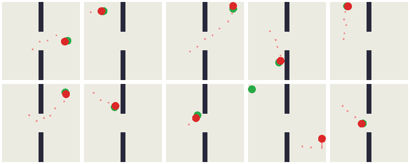

# tworoom

Train a [LeWorldModel (LeWM)](https://github.com/jwgit12/lewm) on offline data from a tiny Two-Room game, then use it to plan toward a goal image.

A red dot moves in a square arena split by a wall with one door. The action is a 2D velocity. The game is a toy version of the Two-Room task from the LeWM paper. Everything is plain PyTorch with no other dependencies.



*LeWM planning toward goal frames (green). Pink is the path taken. From the 1,600-episode model with a 20-step horizon.*

## Files

- `tworoom.py`: the game, a batched random-walk data generator, and a dependency-free PNG writer.
- `train.py`: the LeWM training loop: windows with frameskip, AdamW with warmup and cosine decay, per-epoch validation, a "nothing moves" baseline, and a linear position probe.
- `plan.py`: goal-reaching with model-predictive control. CEM searches over action plans imagined with `model.rollout`. `--planner oracle` runs the same search on the true game as an upper bound.

## Usage

```bash
pip install -r requirements.txt

python tworoom.py                 # 400 episodes x 64 steps -> data/tworoom.pt
python train.py                   # 20 epochs -> checkpoints/lewm_tworoom.pt
python plan.py                    # 50 random start/goal pairs -> plans.png
python plan.py --planner oracle   # same planner on the true game
```

To get the best result below, train on 4x more data with the same number of gradient steps, then plan with a longer horizon:

```bash
python tworoom.py --episodes 1600 --seed 1 --out data/tworoom_1600.pt
python train.py --data data/tworoom_1600.pt --epochs 5 --out checkpoints/lewm_tworoom_1600.pt
python plan.py --ckpt checkpoints/lewm_tworoom_1600.pt --horizon 20
```

Tested on an Apple M4 Pro (MPS) with Python 3.14 and torch 2.14. Training takes about 7 minutes. Planning takes 10–20 seconds per episode.

## Results

Success means the dot gets within one dot radius of the goal within 25 model steps (125 raw actions). Each row uses the same 50 tasks.

| Planner | Training data | Horizon | Overall | Same room (27) | Through the door (23) |
|---|---|---|---|---|---|
| Oracle (true game) | – | 10 | 98% | 100% | 96% |
| LeWM | 400 episodes | 5 | 44% | 67% | 17% |
| LeWM | 400 episodes | 10 | 58% | 93% | 17% |
| LeWM | 1,600 episodes | 10 | 60% | 85% | 30% |
| LeWM | 1,600 episodes | 20 | **70%** | 93% | **43%** |

With 50 tasks, differences of a few tasks are within noise.

## Notes

- **BatchNorm statistics are recalibrated before each evaluation.** LeWM's projector uses BatchNorm, whose running averages lag behind the weights at a high learning rate. Without recalibration, validation and planning in eval mode look up to 10x worse than the model really is.
- **The planning cost averages the distance to the goal over all planned steps.** With a cost on the final step only, every plan that ends at the goal scores the same. The executed first action is then arbitrary and the agent wanders.
- **Latent distance is a weak guide over long distances.** SIGReg spreads the embeddings over all 192 dimensions, while the game's true state is just the dot's 2D position. Only about 9% of the embedding variance is a linear function of position, and latent distance correlates only weakly with true distance (Spearman ≈ 0.25). In door tasks, LeWM's cost rates the correct path only about 10% better than wrong ones. This is the main gap to the oracle.
