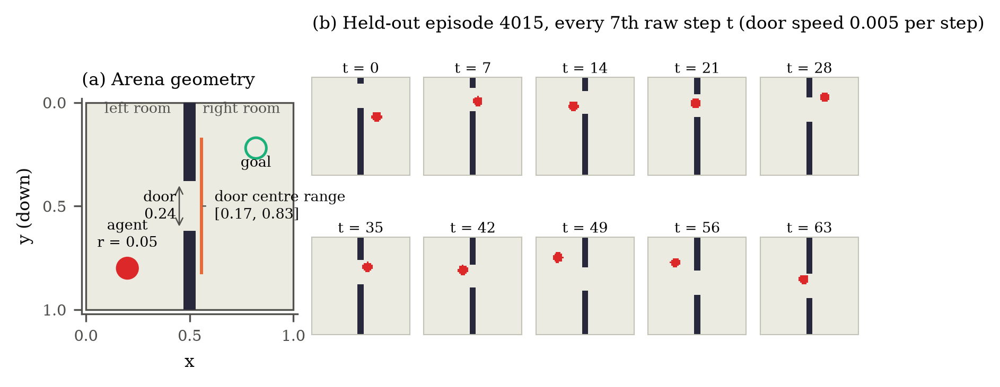
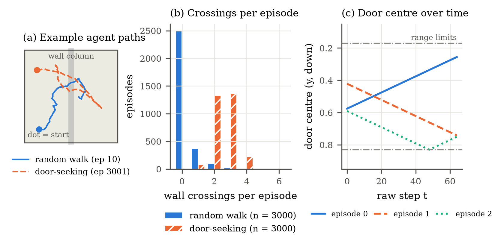
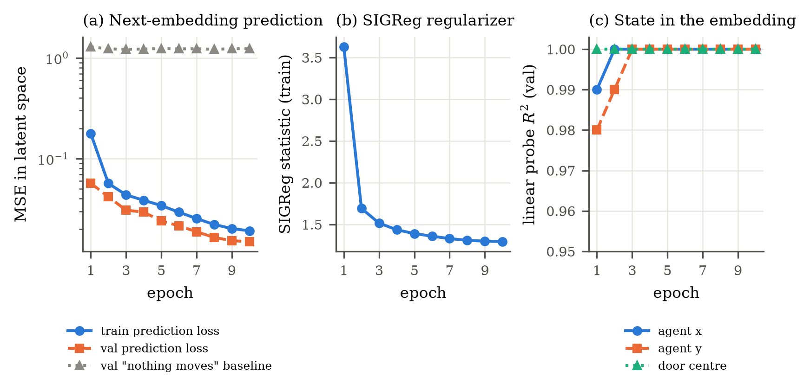
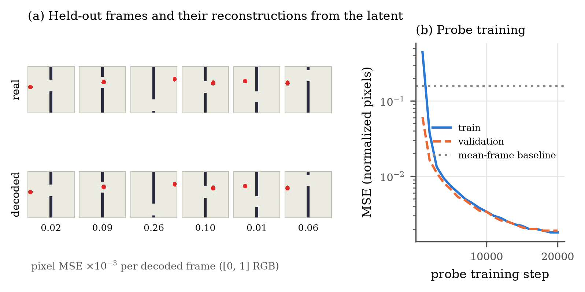
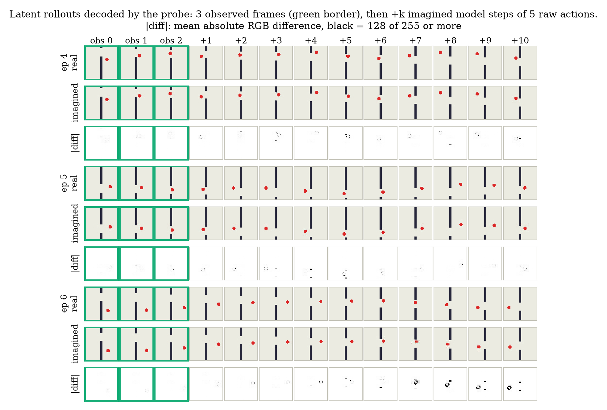
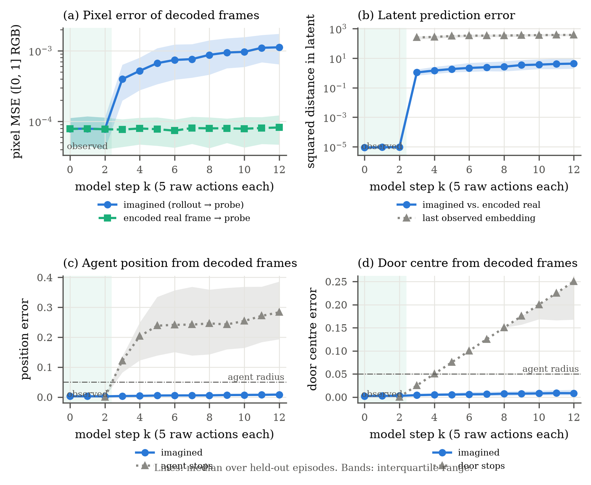
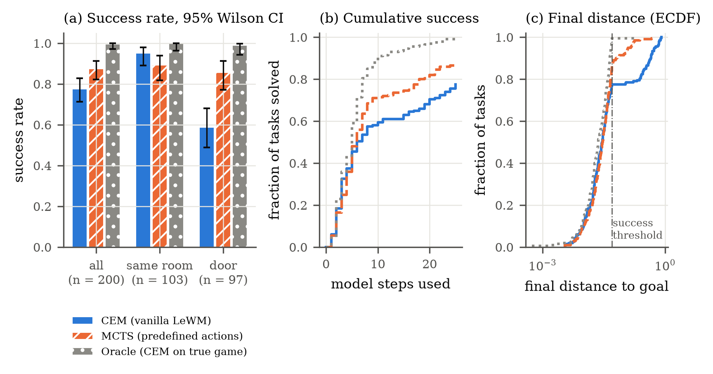
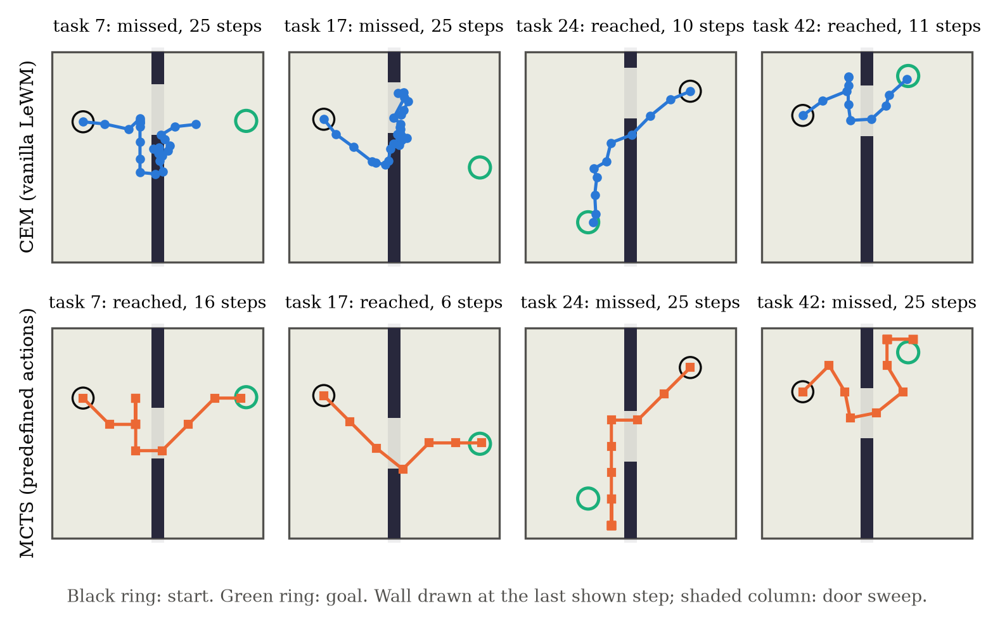

# Planning with a Latent World Model in a Two-Room Environment with a Moving Door

This document describes one study. It gives the environment, the data, the model, the training, the visual probe, the planners, the evaluation and the results. You can use the text and the figures in a scientific thesis.

**Writing standard.** The text uses the writing rules of ASD-STE100 (Simplified Technical English) where possible. Sentences are short and in the active voice, and each sentence gives one statement. Machine-learning names (for example "embedding", "encoder", "Monte Carlo tree search") are Technical Names. Section 1 defines them. No formal STE checker examined this text.

**Source of the numbers.** The script `figures.py` calculates all numbers in this document from the saved dataset, model, logs and planning results. The script also writes them to `experiments/figures/summary.json`. The figures are in `experiments/figures/` as PDF (vector) and PNG (300 dpi) files.

---

## 1. Terms

| Term | Definition in this document |
|---|---|
| Agent | The red disc that the actions move. |
| Raw step | One step of the environment. One action moves the agent once. |
| Model step | Five raw steps. The world model sees one frame for each model step. |
| Frameskip | The number of raw steps in one model step. Here, the frameskip is 5. |
| Episode | One recorded sequence of 64 raw steps (65 frames) in the dataset. |
| Task | One planning problem: a start position, a goal position and a start state of the door. |
| Embedding | The 192-dimensional vector that the model makes from one frame. |
| Latent space | The space of all embeddings. |
| Rollout | A sequence of embeddings that the model predicts from frames and actions, without new frames. |
| Visual probe | A separate network that makes an image from one embedding. It shows what an embedding contains. |
| Planner | An algorithm that selects the actions that move the agent to the goal. |
| Context frames | The last observed frames that the planner gives to the model. Here, there are 3. |

---

## 2. The Two-Room environment

### 2.1 Geometry and dynamics

The environment is a square arena with the coordinates $[0, 1] \times [0, 1]$. The $y$ axis points down. A vertical wall divides the arena into a left room and a right room. The wall has one door. The agent is a disc. Figure 1(a) shows the geometry.



*Figure 1. (a) Arena geometry. (b) Ten frames of one held-out episode. Every 7th raw step is shown. The door moves up, and the agent goes through it.*

| Parameter | Value |
|---|---|
| Arena | $[0, 1]^2$, $y$ points down |
| Wall | $x \in [0.47, 0.53]$, full height except for the door |
| Door height | 0.24 |
| Door centre range | $[0.17, 0.83]$ (a margin of 0.05 of wall stays above and below the door) |
| Door speed | 0.005 per raw step (0.025 per model step) |
| Agent radius | 0.05 |
| Action | 2D velocity $a \in [-1, 1]^2$ |
| Agent speed | $0.025 \cdot a$ per raw step (maximum 0.125 per model step on each axis) |
| Frame | 64 × 64 RGB, 8 bit |

One raw step has three parts:

1. The door centre moves by 0.005 in its current direction. At the end of its range, the direction changes.
2. If the wall now touches the agent, the agent moves vertically into the door opening. Thus the wall carries the agent.
3. The agent moves by $0.025 \cdot a$. If this position is not free, the agent moves only along the free axis. If no axis is free, the agent stays.

A position is free when the agent is fully in the arena and does not touch the wall. An agent in the wall column is free only when it is fully in the door opening.

### 2.2 Rendering

The environment draws each state as one 64 × 64 RGB frame. The background is (235, 235, 225), the wall is (40, 40, 60) and the agent is (220, 40, 40). The frame shows the wall and the agent, but it does not show the direction of the door. A single frame thus does not give the full state. The model must find the direction of the door from more than one frame.

---

## 3. Dataset

### 3.1 Generation

The script `tworoom.py` makes 6,000 episodes with 64 raw steps each:

```bash
python tworoom.py --moving-door 0.005 --door-seeking 0.5 --episodes 6000 --seed 2 \
    --out data/tworoom_6000_moving_slow_seek.pt
```

Each episode starts with a random door centre in $[0.17, 0.83]$, a random door direction and a random free agent position. Two policies make the actions:

- **Random walk (episodes 0–2999).** The first action is uniform in $[-1, 1]^2$. Each next action is $a_t = \mathrm{clip}(a_{t-1} + 0.4\,\varepsilon_t, -1, 1)$, with $\varepsilon_t \sim \mathcal{N}(0, I)$.
- **Door-seeking (episodes 3000–5999).** The random walk continues, but a pull goes to a waypoint: $a_t = \mathrm{clip}(0.5\,a^{\text{walk}}_t + 0.8\,u_t, -1, 1)$. Here, $u_t$ is the unit vector to the waypoint. The first waypoint is the door centre. After a crossing, the waypoint is a random point in the new room. When the agent is less than 0.1 from that point, the waypoint is the door again.

The dataset keeps the frames, the actions, the agent positions and the door centre for each raw step. The model uses only the frames and the actions. The evaluation uses the positions and the door centres.

### 3.2 Statistics

| Quantity | Random walk | Door-seeking | All |
|---|---|---|---|
| Episodes | 3,000 | 3,000 | 6,000 |
| Episodes with at least one wall crossing | 16.7% | 100% | 58.4% |
| Mean wall crossings per episode | 0.23 | 2.58 | 1.41 |

The frames use 4.6 GB (uint8). Figure 2 shows two example paths, the distribution of crossings and the door motion.



*Figure 2. (a) One random-walk path and one door-seeking path. (b) Wall crossings per episode for the two policies. (c) Door centre over time for three episodes. The door changes direction at the range limits.*

### 3.3 Why these settings

Pilot runs (not in this report) used a faster door (0.01 per raw step), fewer crossings and less data. In these runs, the model did not keep the door position in its predictions. The slower door, the door-seeking episodes, more data and longer training removed this problem together. The pilot runs did not find which of these changes is necessary.

---

## 4. Model: LeWorldModel (LeWM)

### 4.1 Architecture

LeWM is a joint-embedding predictive architecture (JEPA). It predicts the next embedding, not the next frame. The study uses the `lewm` package at commit `461b07e`.

| Part | Function | Configuration |
|---|---|---|
| Encoder | ViT. It makes one CLS vector from one frame. | 64 × 64 input, 16 × 16 patches (16 patches), width 192, depth 6, 3 heads, MLP 768 |
| Projector | MLP with BatchNorm. It makes the embedding from the CLS vector. | 192 → 2048 → 192 |
| Action encoder | It makes an action embedding from one model-step action. | input 10 (5 raw actions × 2), hidden 10, ratio 4 |
| Predictor | Causal transformer. AdaLN-zero applies the actions. It predicts the next embedding. | depth 4, 16 heads of 64, MLP 2048, dropout 0.1, history 3 |
| Prediction projector | MLP with BatchNorm after the predictor | 192 → 2048 → 192 |

The model has 11.76 million parameters. The input frames are normalized with the ImageNet mean and standard deviation. The actions are normalized with the mean and standard deviation of the training actions. The action of one model step is the 5 raw actions in sequence (10 numbers). In the dataset, the 5 raw actions of a model step are different from each other.

### 4.2 Loss

The loss has two terms:

$$\mathcal{L} = \mathrm{MSE}\big(\hat z_{t+1}, z_{t+1}\big) + 0.09 \cdot \mathrm{SIGReg}(z).$$

The first term compares the predicted embedding with the embedding of the real next frame. No stop-gradient is used, so the encoder and the predictor train together. SIGReg (Sketched Isotropic Gaussian Regularizer) prevents a collapse of the embeddings. For each time step, it projects the batch of embeddings onto 1,024 random directions. Then it applies the Epps–Pulley normality test at 17 points of the characteristic function. A low value means that the embeddings are near an isotropic Gaussian distribution.

### 4.3 Training

```bash
python train.py --data data/tworoom_6000_moving_slow_seek.pt --epochs 10 \
    --out checkpoints/lewm_tworoom_6000_moving_slow_seek.pt
```

| Setting | Value |
|---|---|
| Split | 90% of the episodes for training (5,400), 10% for validation (600), split by episode, seed 0 |
| Training window | 4 model steps (history 3 + 1 prediction) = 4 frames, 20 raw steps |
| Windows | 243,000 training, 27,000 validation |
| Optimizer | AdamW, learning rate $3 \cdot 10^{-4}$, weight decay $10^{-3}$ |
| Schedule | Linear warmup for 5% of the steps, then cosine decay to 0 |
| Batch size | 128 |
| Epochs and steps | 10 epochs, 18,980 steps |
| Precision | bfloat16 autocast, gradient norm clip 1.0 |
| BatchNorm | The running statistics are calculated again before each evaluation |
| Hardware | NVIDIA RTX PRO 4000 Blackwell Laptop GPU (16 GB), 40 s per epoch |

### 4.4 Training results



*Figure 3. (a) Prediction loss in the latent space. The "nothing moves" baseline predicts that the next embedding is equal to the current embedding. (b) SIGReg statistic. (c) R² of a linear probe from the embedding to the agent position and the door centre, on validation frames.*

After 10 epochs, the validation prediction loss is 0.0150. The "nothing moves" baseline is 1.236, thus the prediction is 82 times better. The SIGReg statistic decreases from 3.63 to 1.29.

A linear probe measures the state information in the embedding. It is a least-squares fit from the embedding to the agent $x$, the agent $y$ and the door centre. The fit uses training windows, and the score uses validation windows. From epoch 3, the R² is 1.00 for all three quantities. Thus a linear function of the embedding gives the full state.

---

## 5. Visual probe

### 5.1 Architecture and training

The visual probe makes a 64 × 64 frame from one embedding. It is the decoder of LeWM, App. D. The model stays frozen. The probe uses the projector output (the latent space of the planner). Thus the probe can also decode the embeddings of a rollout.

| Setting | Value |
|---|---|
| Input | One embedding (192) as the only key and value token |
| Queries | 64 learned queries, one for each 8 × 8 pixel patch |
| Blocks | 4 × (cross-attention + MLP), width 256, 8 heads, MLP 1024 |
| Output | A linear layer makes one 8 × 8 × 3 patch from each query |
| Parameters | 3.27 million |
| Training data | The embeddings of all 351,000 frames of the training episodes |
| Loss | MSE in the normalized pixel space |
| Optimizer | AdamW, learning rate $3 \cdot 10^{-4}$, weight decay $10^{-3}$, 500 warmup steps, cosine decay |
| Steps | 20,000, batch size 256 |

```bash
python probe.py --space emb --rollout-context 3 \
    --out checkpoints/probe_tworoom_6000_moving_slow_seek_emb.pt
```

### 5.2 Reconstruction of single frames



*Figure 4. (a) Held-out frames (top) and their reconstructions from the embedding (bottom). The number below each frame is the pixel MSE in the [0, 1] RGB space. (b) Probe loss during training. The mean-frame baseline always predicts the mean training frame.*

The validation MSE is 0.0019 in the normalized pixel space. The mean-frame baseline is 0.1584, thus the probe is 83 times better. The reconstructions show the agent and the door at the correct positions.

---

## 6. Latent rollouts

### 6.1 Procedure

The evaluation uses all 600 validation episodes. For each episode:

1. The model encodes the frames of model steps 0, 1 and 2 (raw steps 0, 5 and 10).
2. The model predicts the embeddings of model steps 3 to 12 from the recorded actions. It gets no more frames.
3. The probe decodes each embedding to a frame.

Four measurements compare the result with the real episode:

| Measurement | Definition |
|---|---|
| Pixel error | MSE between the decoded frame and the real frame, [0, 1] RGB |
| Latent error | Squared distance between the predicted embedding and the embedding of the real frame |
| Agent position error | Distance between the agent positions. The position in a decoded frame is the centroid of the red pixels. |
| Door centre error | Absolute difference of the door centres. The door centre in a decoded frame is the centre of the background pixels in the wall column. |

Two baselines show the scale. "Agent stops" and "door stops" keep the last observed position. "Last observed embedding" keeps the last observed embedding. The pixel error of the probe on encoded real frames gives the lowest error that the probe can get.

### 6.2 Results



*Figure 5. Three held-out episodes with a wall crossing. For each episode: the real frames, the decoded rollout, and the mean absolute RGB difference. A green border shows an observed frame. "+k" is the k-th predicted model step.*



*Figure 6. Rollout errors over the model steps, for all 600 validation episodes. Lines show the median, and bands show the interquartile range. Model steps 0–2 are observed. (a) Pixel error of the decoded frames. (b) Latent error. (c) Agent position error. (d) Door centre error.*

Median errors (model step 2 is the last observed step):

| Model step $k$ | 2 | 3 | 6 | 9 | 12 |
|---|---|---|---|---|---|
| Agent position error, rollout | 0.002 | 0.003 | 0.005 | 0.007 | 0.008 |
| Agent position error, agent stops | 0 | 0.121 | 0.241 | 0.243 | 0.283 |
| Door centre error, rollout | 0.003 | 0.004 | 0.006 | 0.007 | 0.008 |
| Door centre error, door stops | 0 | 0.025 | 0.100 | 0.175 | 0.250 |
| Pixel error, rollout | $8 \cdot 10^{-5}$ | $4.0 \cdot 10^{-4}$ | $7.4 \cdot 10^{-4}$ | $9.5 \cdot 10^{-4}$ | $1.1 \cdot 10^{-3}$ |
| Pixel error, encoded real frame | $8 \cdot 10^{-5}$ | $8 \cdot 10^{-5}$ | $7 \cdot 10^{-5}$ | $8 \cdot 10^{-5}$ | $8 \cdot 10^{-5}$ |
| Latent error, rollout | $\approx 0$ | 1.09 | 2.20 | 3.44 | 4.29 |
| Latent error, last observed embedding | 0 | 252 | 339 | 358 | 378 |

After 10 predicted model steps (50 raw actions), the median agent position error is 0.008. This is less than one sixth of the agent radius. The door centre error is also 0.008. Thus the model predicts the motion of the agent and the motion of the door. The pixel error of the rollout increases with each step. At step 12, it is 14 times the error of the probe on real frames. The decoded frames show the agent and the door clearly (Figure 5). In fewer than 0.2% of the decoded frames, the readout finds no agent.

---

## 7. Planning

### 7.1 Tasks

The script `plan.py` makes 200 tasks with seed 0. Each task has:

- a random door centre in $[0.17, 0.83]$ and a random door direction,
- a random start position and a random goal position, both free and outside the wall column.

In 97 tasks, the start and the goal are in different rooms ("door tasks"). In 103 tasks, they are in the same room ("same-room tasks"). The goal frame shows the agent at the goal and the door at its start position.

A task is successful when the agent is less than 0.05 (one agent radius) from the goal. The planner has a budget of 25 model steps (125 raw actions).

### 7.2 Control loop

All planners use model-predictive control:

1. Give the last 3 observed frames and the 2 actions between them to the planner.
2. The planner selects a plan of 20 model steps (100 raw steps).
3. Do the first model step of the plan in the real environment.
4. Do steps 1 to 3 again until the agent is at the goal or the budget is used.

### 7.3 Cost

The LeWM planners use the same cost. For a plan with predicted embeddings $\hat z_1, \dots, \hat z_H$ and the goal embedding $z_g$:

$$C = \frac{1}{H} \sum_{h=1}^{H} \lVert \hat z_h - z_g \rVert_2^2, \quad H = 20.$$

The cost uses the mean over all steps of the plan, not only the last step. With a cost on the last step only, all plans that end at the goal have the same cost. Then the first action is arbitrary.

### 7.4 Planners

**CEM (vanilla LeWM).** The cross-entropy method of the original Two-Room code. One plan is 20 actions in $[-1, 1]^2$. Each action stays the same for the 5 raw steps of its model step.

| Setting | Value |
|---|---|
| Samples per iteration | 300 |
| Elites | 30 |
| Iterations | 10 |
| Initial distribution | mean 0, standard deviation 1; the next step starts from the last plan, moved by one step |
| Predicted model steps per decision | 300 × 10 × 20 = 60,000 |

**MCTS (predefined actions).** Monte Carlo tree search in the latent space. It uses a new tree for each decision and each task.

| Setting | Value |
|---|---|
| Actions | 9 predefined actions: stop (0, 0), and 8 directions to the edge of $[-1, 1]^2$: (1, 0), (1, 1), (0, 1), (−1, 1), (−1, 0), (−1, −1), (0, −1), (1, −1). Each action stays the same for 5 raw steps. |
| Simulations | 1,000 per decision |
| Selection | UCT, $Q_{\text{norm}} + c\sqrt{\ln N_{\text{parent}} / N_{\text{child}}}$, $c = 1.0$; $Q$ is normalized to the range of values in the tree |
| Expansion | All 9 children in one batched call of the predictor |
| Value of a node | $(R + (H - d)\,r_d)/H$: the sum $R$ of the rewards to depth $d$, then the reward $r_d$ for the remaining steps. The reward is $-\lVert \hat z - z_g \rVert_2^2$. Thus the value has the same scale as the CEM cost. |
| Backup | The highest child value goes to all nodes on the path |
| Decision | The root action with the most visits |
| Predicted model steps per decision | at most 9 × 1,000 = 9,000 |

**Oracle (reference).** The CEM above, with the true environment in place of the model. Its cost is the mean Euclidean distance to the goal over the plan. The oracle shows the best result that this planner, budget and set of tasks can give.

```bash
M=checkpoints/lewm_tworoom_6000_moving_slow_seek.pt
COMMON="--door moving --door-speed 0.005 --context 3 --horizon 20 --episodes 200"
python plan.py --planner lewm --ckpt $M $COMMON --save-results experiments/plan_cem/results.pt
python plan.py --planner mcts --sims 1000 --ckpt $M $COMMON --save-results experiments/plan_mcts/results.pt
python plan.py --planner oracle --ckpt $M $COMMON --save-results experiments/plan_oracle/results.pt
```

### 7.5 Statistics

The success rates have 95% Wilson score intervals. CEM and MCTS solve the same 200 tasks, so the comparison is paired. The exact two-sided McNemar test compares the two planners.

---

## 8. Planning results

### 8.1 Success rates

| Planner | All tasks (200) | Same room (103) | Door (97) |
|---|---|---|---|
| CEM (vanilla LeWM) | 77.5% (155) [71.2, 82.7] | **95.1%** (98) [89.1, 97.9] | 58.8% (57) [48.8, 68.0] |
| MCTS (predefined actions) | **87.5%** (175) [82.2, 91.4] | 89.3% (92) [81.9, 93.9] | **85.6%** (83) [77.2, 91.2] |
| Oracle (reference) | 99.5% (199) [97.2, 99.9] | 100% (103) [96.4, 100] | 99.0% (96) [94.4, 99.8] |

*The brackets give the 95% Wilson interval in percent. The parentheses give the number of successful tasks.*

| Paired comparison, CEM vs. MCTS | Only CEM solved | Only MCTS solved | McNemar $p$ |
|---|---|---|---|
| All tasks | 17 | 37 | 0.009 |
| Same room | 9 | 3 | 0.146 |
| Door | 8 | 34 | $7 \cdot 10^{-5}$ |

| Planner | Mean model steps to the goal (successful tasks) | Median final distance | Time per task |
|---|---|---|---|
| CEM | 7.5 | 0.029 | 11.5 s |
| MCTS | 7.1 | 0.029 | 3.3 s |
| Oracle | 5.7 | 0.023 | 0.1 s |



*Figure 7. (a) Success rate with 95% Wilson intervals. (b) Fraction of tasks that the planner solved within a given number of model steps. (c) Empirical cumulative distribution of the final distance to the goal. The vertical line is the success threshold of 0.05.*



*Figure 8. Four door tasks, planned by CEM (top) and by MCTS (bottom). The markers show the agent position after each model step. The wall shows the door at the last step. The light column shows where the door moved.*

### 8.2 Analysis of the failures

| Planner | Failed tasks | Same room | Door | Median closest distance to the goal | Failed tasks that came closer than 0.10 |
|---|---|---|---|---|---|
| CEM | 45 | 5 | 40 | 0.340 | 1 |
| MCTS | 25 | 11 | 14 | 0.084 | 16 |
| Oracle | 1 | 0 | 1 | 0.184 | 0 |

---

## 9. Discussion

**The model is accurate.** The embedding contains the full state (linear R² of 1.00). The rollouts keep the agent and the door within 0.008 for 10 model steps. Thus the model is not the main cause of the planning failures.

**MCTS is better than CEM on door tasks.** MCTS solves 85.6% of the door tasks, and CEM solves 58.8% ($p = 7 \cdot 10^{-5}$). Over all tasks, MCTS solves 87.5%, and CEM solves 77.5% ($p = 0.009$). MCTS uses at most 15% of the predictions of CEM, and it is 3.4 times faster for each task.

**The two planners fail in different ways.** CEM fails mostly on door tasks (40 of 45). Its failed tasks end far from the goal (median closest distance 0.34). In Figure 8, CEM moves along the wall or stays near the door, but it does not go through. A possible cause is the search: CEM fits one Gaussian distribution and starts each decision from its last plan. Thus it can stay with one type of solution. MCTS compares different first actions in the tree. This study did not test this explanation.

MCTS fails more on same-room tasks (11, against 5 for CEM; $p = 0.15$, not significant). Its failed tasks come near the goal (16 of 25 come closer than 0.10). A possible cause is the action set: the 9 predefined actions move the agent by 0.125 on each axis in one model step. The success threshold is 0.05. Thus the agent can move past the goal. This study did not test this explanation.

**The latent cost is sufficient for this environment.** The oracle solves 99.5% of the tasks with the same CEM and budget. MCTS uses the same latent cost as CEM and solves 87.5%. Thus a better search gives a large part of the possible improvement without a change to the cost.

---

## 10. Limitations

- The study uses one trained model, one dataset seed and one task seed. It does not measure the variance between training runs.
- The planners have no hyperparameter search. The MCTS constant $c$, the number of simulations, the CEM samples and the horizon have fixed values.
- The MCTS uses 9 coarse actions. A finer action set or a local refinement of the first action can change the result on same-room tasks.
- The goal frame shows the door at its start position. The planner cannot change the door. Thus a part of the latent distance to the goal is not under the control of the planner.
- The time per task was measured on one laptop GPU. The CEM run shared the GPU for a short time with the calculation of the figures.
- The environment is simple. The results do not show how the method works with more complex images or dynamics.
- Pilot runs (Section 3.3) selected the dataset settings. This report does not give an ablation of these settings.

---

## 11. Reproduction

### 11.1 Software and hardware

| Item | Version |
|---|---|
| Python | 3.12 |
| PyTorch | 2.14.1 (CUDA 13.2) |
| lewm | commit `461b07e53041644c073628a8ad8967663393b24d` |
| matplotlib | 3.11.2 (for `figures.py`) |
| GPU | NVIDIA RTX PRO 4000 Blackwell Laptop GPU, 16 GB |

### 11.2 Commands

```bash
pip install -r requirements.txt

# 1. Dataset (about 10 s, 4.6 GB of frames)
python tworoom.py --moving-door 0.005 --door-seeking 0.5 --episodes 6000 --seed 2 \
    --out data/tworoom_6000_moving_slow_seek.pt

# 2. LeWM (about 7 min)
mkdir -p experiments/train_6000_moving_slow_seek
python train.py --data data/tworoom_6000_moving_slow_seek.pt --epochs 10 \
    --out checkpoints/lewm_tworoom_6000_moving_slow_seek.pt | tee experiments/train_6000_moving_slow_seek/train.log

# 3. Visual probe (about 6 min)
mkdir -p experiments/probe_6000_moving_slow_seek_emb
python probe.py --space emb --rollout-context 3 | tee experiments/probe_6000_moving_slow_seek_emb/probe.log

# 4. Planning (CEM about 40 min, MCTS about 11 min, oracle about 20 s)
M=checkpoints/lewm_tworoom_6000_moving_slow_seek.pt
COMMON="--door moving --door-speed 0.005 --context 3 --horizon 20 --episodes 200"
for P in cem mcts oracle; do mkdir -p experiments/plan_$P; done
python plan.py --planner lewm --ckpt $M $COMMON --save-png experiments/plan_cem/plans.png --save-results experiments/plan_cem/results.pt
python plan.py --planner mcts --sims 1000 --ckpt $M $COMMON --save-png experiments/plan_mcts/plans.png --save-results experiments/plan_mcts/results.pt
python plan.py --planner oracle --ckpt $M $COMMON --save-png experiments/plan_oracle/plans.png --save-results experiments/plan_oracle/results.pt

# 5. Figures and summary.json (about 15 s)
python figures.py
```

The dataset generation is deterministic: the command above makes the same file again. The training and the planning use fixed seeds, but GPU operations can give small differences.

### 11.3 Files

| File | Content |
|---|---|
| `tworoom.py` | Environment, moving door, data generation, PNG writer |
| `train.py` | LeWM training, validation and linear probe |
| `probe.py` | Visual probe training, reconstructions and rollout decoding |
| `plan.py` | CEM, MCTS and oracle planners, task generation, evaluation |
| `figures.py` | All figures and `summary.json` |
| `experiments/train_6000_moving_slow_seek/train.log` | Training log |
| `experiments/probe_6000_moving_slow_seek_emb/` | Probe log and quick-look images |
| `experiments/plan_{cem,mcts,oracle}/` | Planning logs, per-task results (`results.pt`), quick-look images |
| `experiments/figures/` | Figures 1–8 (PDF and PNG) and `summary.json` |

The folders `data/` and `checkpoints/` are not in the git repository (see `.gitignore`). The commands in Section 11.2 make them again.

---

## References

- LeWorldModel (LeWM): the paper that the `lewm` package implements. The visual probe follows its App. D.
- `lewm` package: https://github.com/jwgit12/lewm
- Two-Room code: https://github.com/jwgit12/tworoom
